# Sổ Xe

An Android app for motorbike and car owners in Vietnam: log every fill-up, see real fuel economy and
cost per kilometre, and get reminded before maintenance is due. Everything works offline; the network
only adds things on top, such as nearby fuel stations and garages.

> Status: early development. The project skeleton is in place; features land one pull request at a time.
> See [CHANGELOG.md](CHANGELOG.md).

## Features

Available now:

- Overview: latest and average fuel economy (L/100 km), cost per km, this month's spending, the
  odometer, and the maintenance items that need attention.
- Statistics: spending and fuel economy per month for the last six months, as bar charts with the exact
  values in a table below.
- Several vehicles, one selected at a time. The top bar shows the selected vehicle; tapping it opens
  the list to switch, add or edit.
- Maintenance by distance or time, whichever comes first. A new vehicle starts with the usual items
  (oil, air filter, tyres, brake pads, and the yearly inspection for cars), sorted by urgency with an
  icon and label for each status. Marking an item done records the date, odometer, cost and note, and
  each item keeps its history.
- Reminders: a daily check notifies once when an item becomes due soon and once more if it becomes
  overdue, for every vehicle. Notification permission is asked for from the Maintenance tab, where it
  makes sense, with a "Not now".
- Fuel log grouped by month with monthly totals. Litres can be typed with a comma or a dot, and the
  price per litre is shown as you type. The odometer must lie between the fill-ups before and after.
- Swipe a fill-up away to delete it, with undo. TalkBack users get the same action from the row.
- Nearby: fuel stations and garages within 3 km from OpenStreetMap, nearest first, with directions in
  your maps app. Location is asked for only on this screen, and every outcome has its own state:
  no permission, refused for good, no position, offline, slow or busy server, no results, and
  switched off remotely.
- Crash reports and four usage events, in release builds only, with no personal data. The "due soon"
  limits and a switch for the Nearby tab can be changed remotely without an update.
- Accessibility: every control has a name TalkBack can read and a touch target of at least 48 dp,
  checked on every screen by a test; state changes on the Nearby screen are announced; the app is
  checked in dark mode, with the largest system font, and in landscape.
- Form errors shown next to each field, and read out by TalkBack.
- Vietnamese and English, chosen per app in Settings (or following the phone), on every supported
  Android version. Settings also turns reminders off and links the privacy policy.

| No vehicle yet | Vehicle form | Vehicles |
| --- | --- | --- |
|  |  |  |

| Overview | Statistics |
| --- | --- |
| 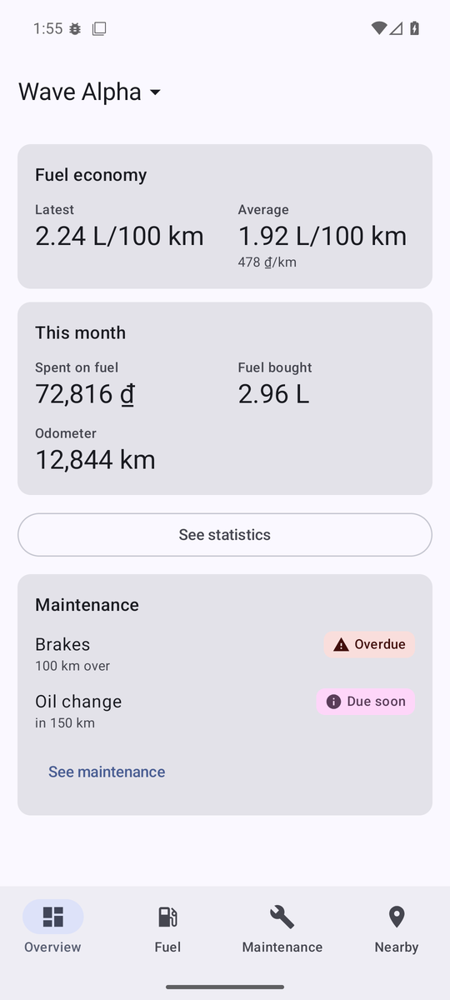 | 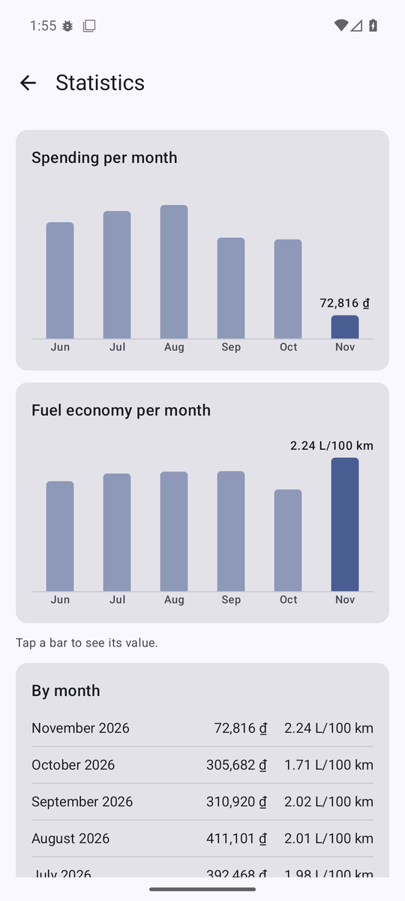 |

| Maintenance | Mark done | Item and history |
| --- | --- | --- |
| 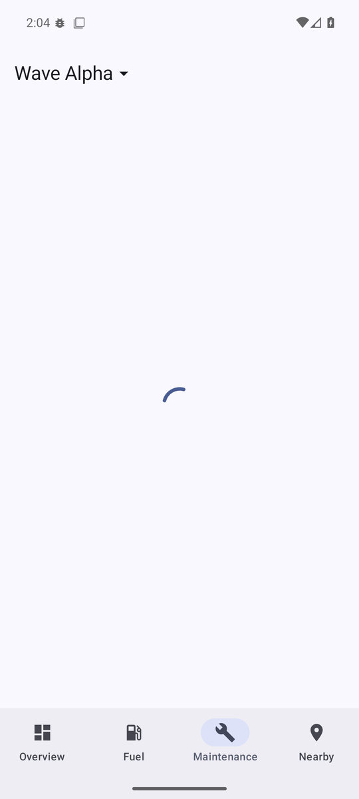 | 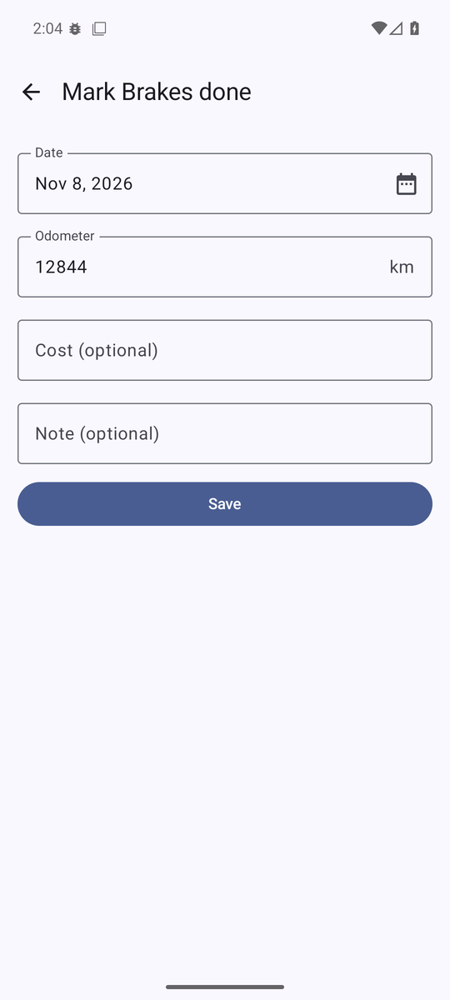 | 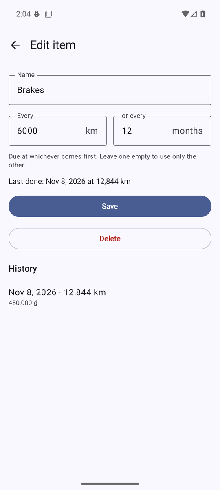 |

| Nearby permission | Nearby |
| --- | --- |
| 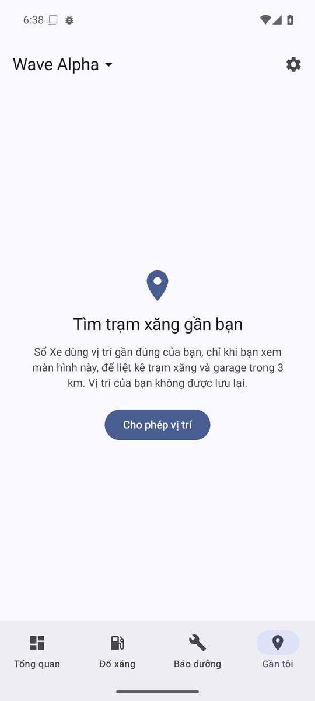 | 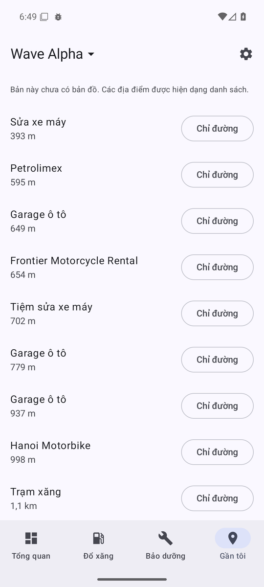 |

| Permission prompt | Reminder |
| --- | --- |
| 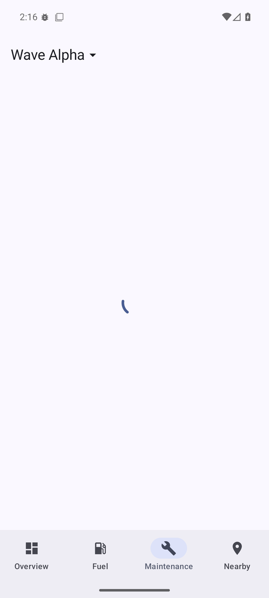 | 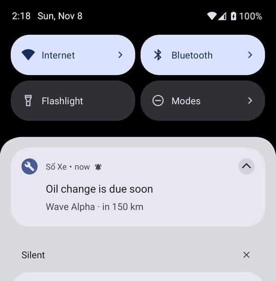 |

| Tổng quan | Bảo dưỡng | Cài đặt |
| --- | --- | --- |
| 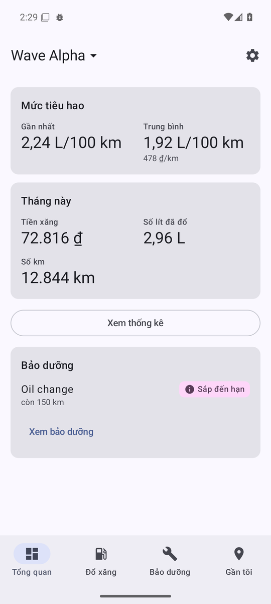 | 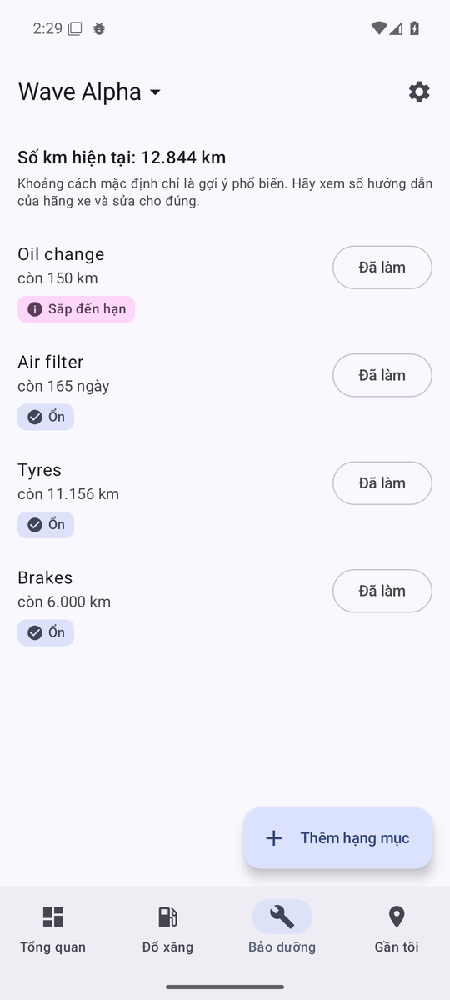 | 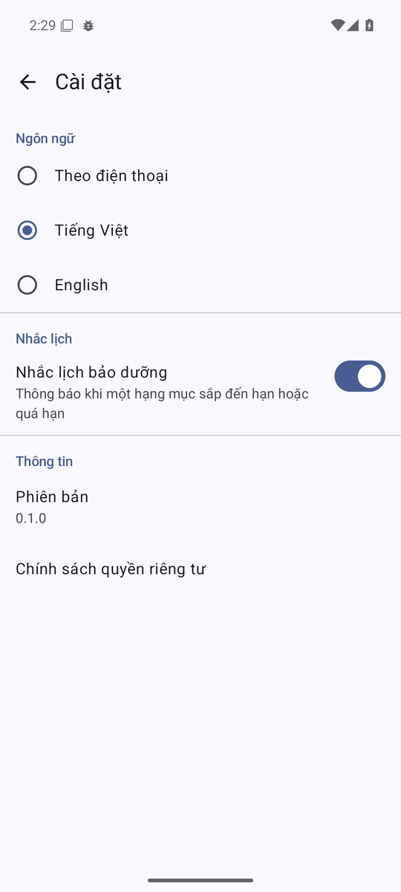 |

| Overview (dark) | Maintenance (dark) | Fuel log (dark) |
| --- | --- | --- |
| 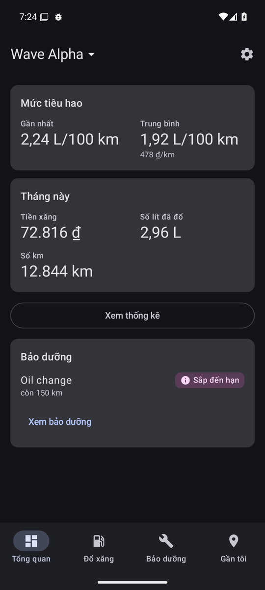 | 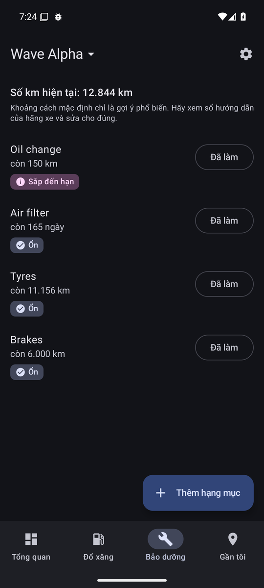 | 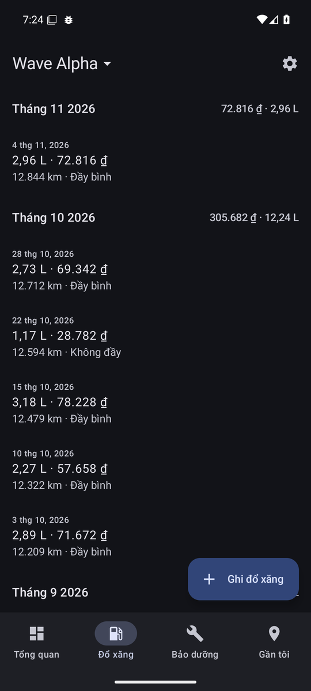 |

| Fill-up form | Fuel log | Undo |
| --- | --- | --- |
|  |  |  |

Planned for v1.0:


## Architecture

Three Gradle modules, so the compiler enforces the boundaries:

```
:app  ──▶  :core:data  ──▶  :core:domain
  └─────────────────────────────▲
```

- `:core:domain` is plain Kotlin with no Android dependency. Models, repository interfaces and the
  calculations that are easiest to get wrong live here and are tested on the JVM.
- `:core:data` implements the repositories with Room, DataStore and Retrofit.
- `:app` holds the Compose UI, ViewModels and Hilt wiring. ViewModels never see Room or Retrofit.

Details in [docs/architecture.md](docs/architecture.md).

## Tech stack

Each library is here because a feature needs it.

| Area | Choice |
| --- | --- |
| Language | Kotlin, Coroutines |
| UI | Jetpack Compose, Material 3, single activity, one `UiState` per screen via `StateFlow` |
| Navigation | Navigation Compose with type-safe routes |
| Dependency injection | Hilt |
| Storage | Room (exported schemas, soft delete), tested with Robolectric; Preferences DataStore |
| Monitoring | Firebase Crashlytics, Analytics and Remote Config through the BoM; the app runs without a Firebase project |
| Maps and location | Maps Compose, Fused Location (approximate, only while the screen is open) |
| Network | Retrofit, OkHttp, kotlinx.serialization; errors as values, retry for GET only; tested with MockWebServer |
| Background work | WorkManager with Hilt workers |
| Localisation | Per-app language with AppCompat, generated locale config |
| Testing | JUnit, kotlinx-coroutines-test, Turbine, fake repositories; Compose UI tests on Robolectric with Hilt |
| Build | Gradle version catalog, KSP, JDK 21 |
| Code quality | ktlint, Android Lint, GitHub Actions on every pull request, including an R8 release build |
| Release | Signing from outside the repository, R8, a tag-triggered workflow that checks the tag against `versionCode` |

Maps Compose and Firebase are added
by the features that use them.

## Build

Requirements: JDK 21 and the Android SDK with platform 37.

```sh
./gradlew assembleDebug          # build the debug APK
./gradlew test                   # unit tests and the main-flow UI test (Robolectric, no emulator)
./gradlew ktlintCheck lint       # style and static checks, same as CI
./gradlew assembleRelease        # release build with R8, unsigned without a keystore (see docs/release.md)
```

No secrets are needed yet. See [docs/setup.md](docs/setup.md) for local configuration.

## Decisions

Architecture decision records live in [docs/adr/](docs/adr/):

1. [Three modules instead of one module per feature](docs/adr/0001-three-modules.md)
2. [Money and volume stored as integers](docs/adr/0002-integer-money-and-volume.md)
3. [Fuel economy by the full-tank method](docs/adr/0003-full-tank-fuel-economy.md)
4. [Network errors as values, retry only for idempotent requests](docs/adr/0004-network-errors-and-retry.md)

## License

[Apache License 2.0](LICENSE)
