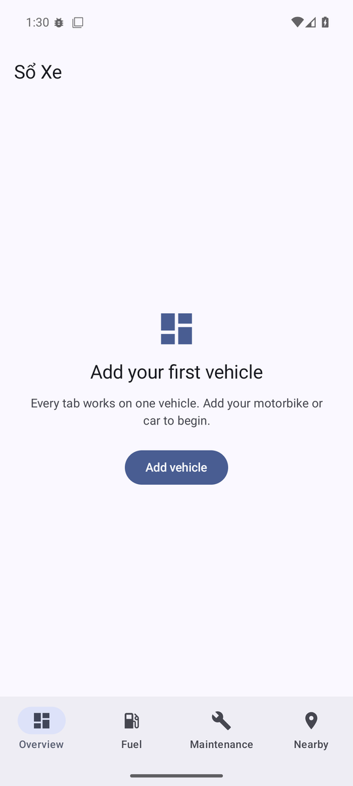
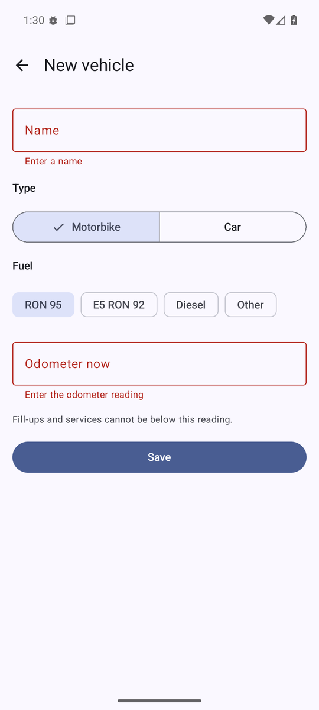
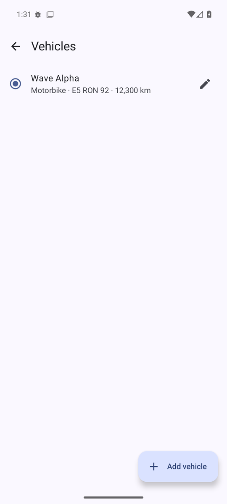
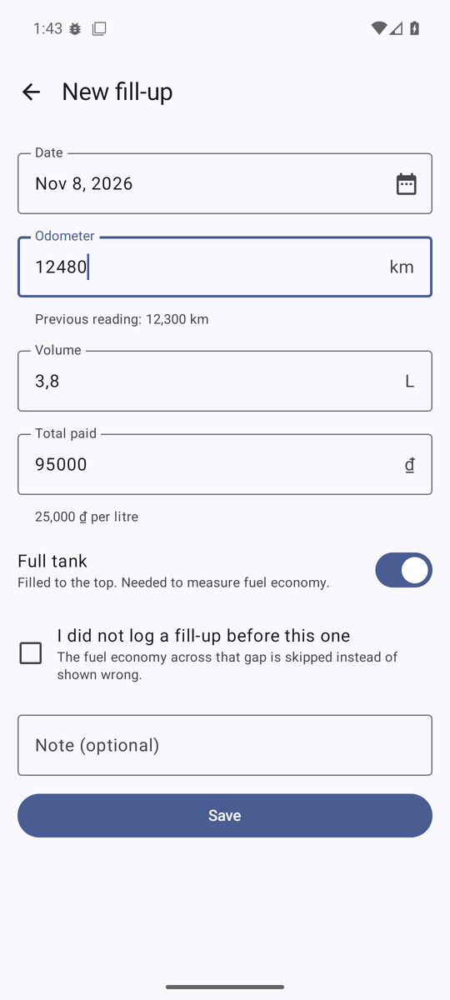
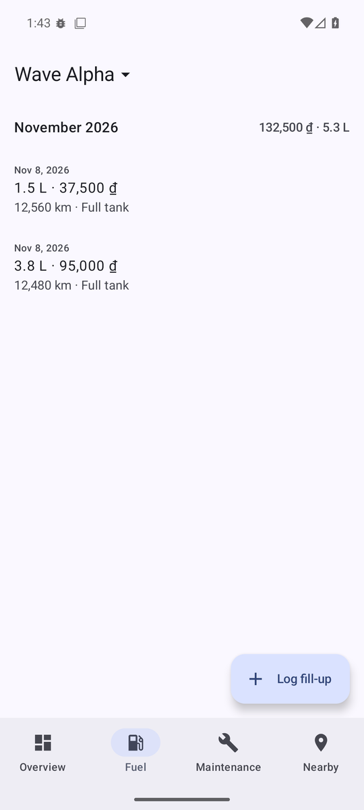
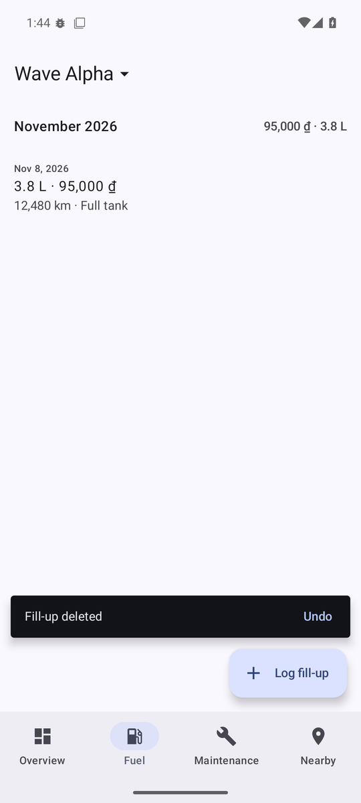

# Sổ Xe

An Android app for motorbike and car owners in Vietnam: log every fill-up, see real fuel economy and
cost per kilometre, and get reminded before maintenance is due. Everything works offline; the network
only adds things on top, such as nearby fuel stations and garages.

> Status: early development. The project skeleton is in place; features land one pull request at a time.
> See [CHANGELOG.md](CHANGELOG.md).

## Features

Available now:

- Several vehicles, one selected at a time. The top bar shows the selected vehicle; tapping it opens
  the list to switch, add or edit.
- Fuel log grouped by month with monthly totals. Litres can be typed with a comma or a dot, and the
  price per litre is shown as you type. The odometer must lie between the fill-ups before and after.
- Swipe a fill-up away to delete it, with undo. TalkBack users get the same action from the row.
- Form errors shown next to each field, and read out by TalkBack.

| No vehicle yet | Vehicle form | Vehicles |
| --- | --- | --- |
|  |  |  |

| Fill-up form | Fuel log | Undo |
| --- | --- | --- |
|  |  |  |

Planned for v1.0:

- Fuel economy (L/100 km), cost per km and monthly charts
- Maintenance items due by distance or by time, with reminders
- Nearby fuel stations and garages on a map
- Vietnamese and English

## Architecture

Three Gradle modules, so the compiler enforces the boundaries:

```
:app  ──▶  :core:data  ──▶  :core:domain
  └─────────────────────────────▲
```

- `:core:domain` is plain Kotlin with no Android dependency. Models, repository interfaces and the
  calculations that are easiest to get wrong live here and are tested on the JVM.
- `:core:data` implements the repositories with Room, DataStore and Retrofit.
- `:app` holds the Compose UI, ViewModels and Hilt wiring. ViewModels never see Room or Retrofit.

Details in [docs/architecture.md](docs/architecture.md).

## Tech stack

Each library is here because a feature needs it.

| Area | Choice |
| --- | --- |
| Language | Kotlin, Coroutines |
| UI | Jetpack Compose, Material 3, single activity, one `UiState` per screen via `StateFlow` |
| Navigation | Navigation Compose with type-safe routes |
| Dependency injection | Hilt |
| Storage | Room (exported schemas, soft delete), tested with Robolectric; Preferences DataStore |
| Testing | JUnit, kotlinx-coroutines-test, Turbine, fake repositories |
| Build | Gradle version catalog, KSP, JDK 21 |
| Code quality | ktlint, Android Lint, GitHub Actions on every pull request |

Retrofit, OkHttp, WorkManager, Maps Compose and Firebase are added
by the features that use them.

## Build

Requirements: JDK 21 and the Android SDK with platform 37.

```sh
./gradlew assembleDebug          # build the debug APK
./gradlew test                   # unit tests
./gradlew ktlintCheck lint       # style and static checks, same as CI
```

No secrets are needed yet. See [docs/setup.md](docs/setup.md) for local configuration.

## Decisions

Architecture decision records live in [docs/adr/](docs/adr/):

1. [Three modules instead of one module per feature](docs/adr/0001-three-modules.md)
2. [Money and volume stored as integers](docs/adr/0002-integer-money-and-volume.md)
3. [Fuel economy by the full-tank method](docs/adr/0003-full-tank-fuel-economy.md)

## License

[Apache License 2.0](LICENSE)
